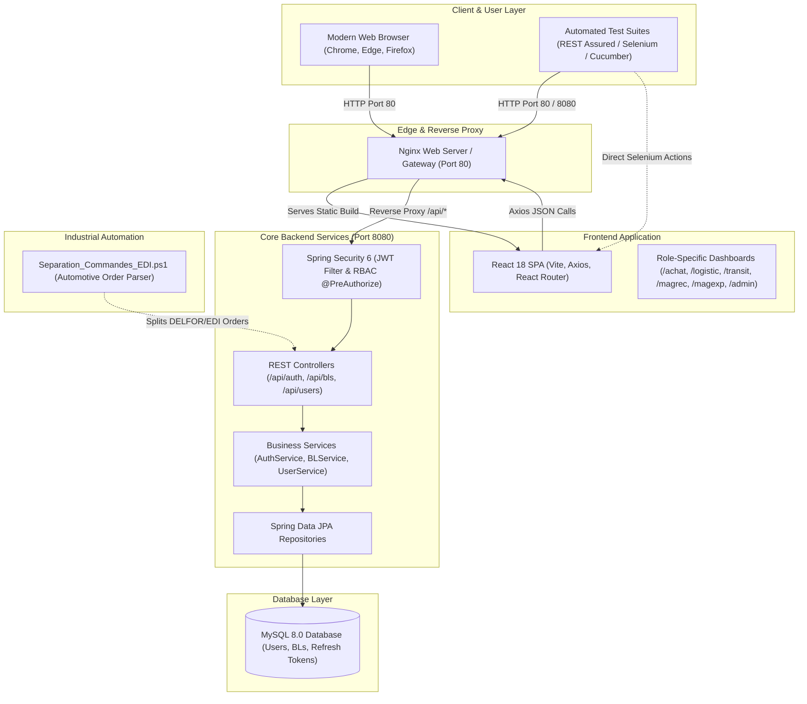

# Portail Logistique — Clayens NP Morocco
### Industrial Supply Chain & Delivery Tracking Platform | Full-Stack Development & QA Automation Suite


---

## 📌 Executive Summary

The **Portail Logistique Clayens NP Morocco** is an enterprise-grade digital logistics and supply-chain tracking platform designed for the **Mohammedia automotive manufacturing site** of the Clayens NP Group.

In high-precision automotive plastic injection manufacturing, timely material traceability and strict customs compliance are critical to prevent factory downtime and assembly-line stops (e.g. for OEMs like Stellantis and Renault). This application centralizes, digitizes, and audits the entire lifecycle of **Bons de Livraison (BL)** (Delivery Notes) and incoming/outgoing shipping operations across six specialized industrial departments: **Achats (Purchasing)**, **Logistique (Logistics & Flow)**, **Magasin Réception (Inbound Warehouse)**, **Magasin Expédition (Outbound Warehouse)**, **Transit (Customs & Clearing)**, and **Direction (Administration)**.

In addition to full-stack implementation, this repository houses an **industrial test automation ecosystem** implementing:
1. **REST Assured** API automation with encapsulated Clients, JSON Schema validation, POJO mapping, and Request Chaining.
2. **Selenium WebDriver** UI automation with the Page Object Model (POM), thread-safe drivers, explicit waits, and TestNG listeners with failure screenshot capture.
3. **Cucumber BDD** acceptance testing with clean separation between Gherkin business features, UI Step Definitions delegating to Page Objects, and API Step Definitions delegating to API Clients.

---

## 🏗️ System Architecture



---

## 💼 Core Business Features & RBAC Matrix

The system enforces strict **Role-Based Access Control (RBAC)** at the backend database and API layer, ensuring that field edits are cryptographically governed by user roles rather than just hidden in the UI:

| Department Role | Industrial Responsibility | Field Modification Rights on BL | Operational Scope |
| :--- | :--- | :--- | :--- |
| **Achats (Purchasing)** | Supplier order placement & procurement | `clientFournisseur`, `enlevement` (expected date), `commentaire` | Tracks supplier deliveries and purchase dates |
| **Logistique (Logistics & Flow)** | Plant transport planning & supply chain | `clientFournisseur`, `operation` (`ACHAT`/`VENTE`), `commentaire` | Orchestrates internal and external factory flows |
| **Transit (Customs)** | Port clearance & import/export declarations | `clientFournisseur`, `douane` (`EN_COURS`, `BLOQUE`, `DEDOUANE`), `livraison`, `commentaire` | Resolves customs bottlenecks at Casablanca/Tanger ports |
| **Magasin Réception** | Inbound dock unloading & inspection | `clientFournisseur`, `enlevement`, `livraison` (`OUI`/`NON`), `commentaire` | Confirms physical receipt of raw injection polymers |
| **Magasin Expédition** | Outbound packing & customer dispatch | `clientFournisseur`, `enlevement`, `livraison`, `commentaire` | Ships finished automotive sub-assemblies |
| **Direction / Admin** | Plant supervision & user governance | **All fields** + User Account CRUD + BL Deletion | Full administrative audit and system maintenance |

### Key Business Workflows:
- **Urgent Customs Block Alert**: When a shipment's customs status changes to `BLOQUE`, an urgent red notification banner alerts operators across the plant to avoid demurrage fees.
- **Delivery Confirmation Lifecycle**: BL status moves from `NON` $\rightarrow$ `EN_COURS` $\rightarrow$ `OUI` upon physical dock delivery.
- **Automotive EDI Ingestion**: `scripts/Separation_Commandes_EDI.ps1` separates OEM electronic orders (DELFOR/DELJIT) into supplier batches for automated entry into the portal.

---

## 🧪 Quality Assurance & Test Automation Architecture

The test automation ecosystem in `automation-tests/` is aligned with enterprise testing methodologies and the **three reference guides** (**REST Assured**, **Selenium WebDriver**, and **Cucumber**).

### 1. REST Assured API Automation Framework
- **Encapsulated Clients (`com.stageprojet.tests.api.clients`):**
  - [`AuthClient.java`](file:///c:/docs/stageproject.np/automation-tests/src/test/java/com/stageprojet/tests/api/clients/AuthClient.java): Handles authentication, token renewal, and revocation.
  - [`BonLivraisonClient.java`](file:///c:/docs/stageproject.np/automation-tests/src/test/java/com/stageprojet/tests/api/clients/BonLivraisonClient.java): Handles BL creation, updates, and filtering.
  - [`UserClient.java`](file:///c:/docs/stageproject.np/automation-tests/src/test/java/com/stageprojet/tests/api/clients/UserClient.java): Handles administrative user provisioning.
- **Domain POJOs (`com.stageprojet.tests.api.models`):** Bidirectional serialization and deserialization using Jackson (`LoginRequest`, `BonLivraison`, `User`...).
- **Centralized Specs & Tokens (`com.stageprojet.tests.utils`):**
  - `RequestSpec`: Pre-configures base URI, JSON Content-Type, Accept headers, and Bearer authentication.
  - `ResponseSpec`: Centralizes HTTP status code checks (200, 201, 400, 401, 403, 404).
  - `TokenManager`: Thread-safe caching and automated retrieval of JWT tokens.
  - `RetryUtils`: Resilient retry mechanism for transient network spikes.
- **Request Chaining:** Multi-request workflows (e.g. `POST /api/bls` $\rightarrow$ extract dynamic `numBl` $\rightarrow$ `GET /api/bls/{numBl}` $\rightarrow$ `PUT /api/bls/{numBl}` $\rightarrow$ `DELETE /api/bls/{numBl}` $\rightarrow$ assert `404`).
- **JSON Schema Validation:** Contract validation against `login-response-schema.json`, `bl-response-schema.json`, `bl-list-schema.json`, and `user-schema.json` using `io.restassured.module.jsv.JsonSchemaValidator`.
- **Response Time Benchmarking:** Asserting SLA latency `< 2000L` ms using Hamcrest matchers.

### 2. Selenium WebDriver UI Automation Framework
- **Page Object Model (POM):**
  - [`LoginPage.java`](file:///c:/docs/stageproject.np/automation-tests/src/test/java/com/stageprojet/tests/ui/pages/LoginPage.java): Form interaction, login execution, password masking check (`isPasswordMasked()`), error assertion.
  - [`SignupPage.java`](file:///c:/docs/stageproject.np/automation-tests/src/test/java/com/stageprojet/tests/ui/pages/SignupPage.java): Registration, role verification (`isAdminRoleAbsent()`).
  - [`DashboardPage.java`](file:///c:/docs/stageproject.np/automation-tests/src/test/java/com/stageprojet/tests/ui/pages/DashboardPage.java): BL form filling, field editability verification, logout.
  - [`BLsPage.java`](file:///c:/docs/stageproject.np/automation-tests/src/test/java/com/stageprojet/tests/ui/pages/BLsPage.java): BL table consultation, real-time search, "Bloqués uniquement" filter.
  - [`UsersPage.java`](file:///c:/docs/stageproject.np/automation-tests/src/test/java/com/stageprojet/tests/ui/pages/UsersPage.java): Admin user table and modal dialog interactions.
- **BasePage & Explicit Synchronization:** Completely eliminates fragile `Thread.sleep()` in favor of `WebDriverWait` and `ExpectedConditions` (`elementToBeClickable`, `visibilityOfElementLocated`, `urlContains`).
- **BaseTest & DriverManager:** Standardizes test lifecycle (`@BeforeMethod`, `@AfterMethod`) with thread-safe `ThreadLocal<WebDriver>` and headless execution support.
- **Automated Failure Screenshots & Reporting:** Integrated `ScreenshotUtils`, `TestListener`, and `ExtentReportManager` capture timestamped PNG screenshots on test failure and embed them directly into `test-output/ExtentReport.html`.

### 3. Cucumber BDD Acceptance Testing Framework
- **Clean Architecture & Separation of Concerns:**
  - Feature files reside in `src/test/resources/features/ui/` and `src/test/resources/features/api/`.
  - **Golden QA Rule**: Step definitions contain **no** low-level Selenium or RestAssured code; UI steps delegate strictly to **Page Objects**, and API steps delegate strictly to **API Clients**.
- **Data-Driven BDD:** `Scenario Outline` with `Examples` tables for multi-role login, boundary conditions, and invalid credential suites.
- **Scenario Lifecycle Hooks (`Hooks.java`):** Captures screenshots on scenario failure and embeds them into the Cucumber HTML report via `scenario.attach(bytes, "image/png", name)`.
- **Multi-Runner Support:** `CucumberTestRunner` (complete suite), `UiTestRunner` (`@ui`), and `ApiTestRunner` (`@api`).

---

## 📑 Test Documentation & Specifications

The project includes documentation meeting automotive quality standards (**IATF 16949 / ISO 9001**):

| Document | Format | Description & Scope |
| :--- | :--- | :--- |
| **Master Test Plan** | [Markdown](file:///c:/docs/stageproject.np/Test_Plan_Portail_Logistique.md) · [PDF](file:///c:/docs/stageproject.np/Test_Plan_Portail_Logistique_Clayens_NP_Morocco.pdf) | Complete testing strategy, scope, environment, risk mitigation, and deliverables. |
| **Test Scenarios Catalog** | [Markdown](file:///c:/docs/stageproject.np/Test_Scenarios_Portail_Logistique.md) · [PDF](file:///c:/docs/stageproject.np/Test_Scenarios_Portail_Logistique_Clayens_NP_Morocco.pdf) | **170+ scenarios** across 12 modules (Auth, Reg, BL CRUD, RBAC, UI, Security, EDI, NFP, Audit). |
| **Master Test Cases Specification** | [Markdown](file:///c:/docs/stageproject.np/Test_Cases_Portail_Logistique.md) · [PDF](file:///c:/docs/stageproject.np/Test_Cases_Portail_Logistique_Clayens_NP_Morocco.pdf) | **220+ granular test cases** with preconditions, step-by-step procedures, payloads, and expected results. |

---

## 🔌 REST API Reference

All responses conform to the uniform envelope: `{ "success": boolean, "message": string, "data": object, "timestamp": long }`.

| Method | Endpoint | Authorization | Description |
| :--- | :--- | :--- | :--- |
| `POST` | `/api/auth/login` | Public | Authenticates user; returns JWT `accessToken` (15m) and `refreshToken` (7d) |
| `POST` | `/api/auth/register` | Public | Registers operational user (roles: `achat`, `logistic`, `transit`, `magrec`, `magexp`) |
| `POST` | `/api/auth/refresh` | Public / Token | Generates new `accessToken` using active `refreshToken` |
| `POST` | `/api/auth/logout` | Authenticated | Revokes refresh token and invalidates active session |
| `GET` | `/api/bls` | Authenticated | Lists all BLs. Supports filtering: `?operation=ACHAT` or `?operation=VENTE` |
| `GET` | `/api/bls/{numBl}` | Authenticated | Retrieves delivery note by its unique identifier |
| `POST` | `/api/bls` | Authenticated | Creates a new delivery note with creator audit metadata |
| `PUT` | `/api/bls/{numBl}` | Authenticated | Updates delivery note (backend enforces role-permitted fields only) |
| `DELETE`| `/api/bls/{numBl}` | **Admin Only** | Deletes delivery note permanently from system |
| `GET` | `/api/users` | **Admin Only** | Lists all registered plant users |
| `GET` | `/api/users/{id}` | **Admin Only** | Retrieves user details by ID |
| `POST` | `/api/users` | **Admin Only** | Creates new administrative or operational accounts |
| `DELETE`| `/api/users/{id}` | **Admin Only** | Deletes user account (prevents self-deletion) |

---

## 🚀 Step-by-Step Setup & Execution Guide

### Prerequisites
- **Java Development Kit (JDK)**: Version 17 or higher (tested on JDK 17 and JDK 25)
- **Node.js**: Version 18.x or 20.x+ & npm
- **Apache Maven**: Version 3.8+ or 3.9+
- **Docker Desktop**: With Docker Compose enabled
- **MySQL Server 8.0**: Running locally or accessible via container/host

---

### Option 1: 1-Click Startup on Windows (Local Dev Mode)

Run the included automated launcher script:
```powershell
.\start.bat
```
*This starts the Spring Boot backend on port 8080, launches Vite frontend on port 5173, and opens your default browser automatically.*

---

### Option 2: Containerized Deployment with Docker Compose

1. **Configure Environment Variables:**
   ```powershell
   # Copy the template if .env does not already exist
   if (-not (Test-Path .env)) { Copy-Item .env.example .env }
   ```
   *Edit `.env` to configure your MySQL connection and generate a random 32-byte Base64 secret for `JWT_SECRET`:*
   ```powershell
   $bytes = New-Object byte[] 32; [System.Security.Cryptography.RandomNumberGenerator]::Create().GetBytes($bytes); [Convert]::ToBase64String($bytes)
   ```

2. **Build and Run with Docker Compose:**
   ```powershell
   docker compose up --build -d
   ```

3. **Verify Service Health:**
   - **Frontend UI**: [http://localhost](http://localhost) (Proxied via Nginx)
   - **Backend API**: [http://localhost:8080](http://localhost:8080)
   - **Actuator Health Check**: [http://localhost/actuator/health](http://localhost/actuator/health)

4. **Shutdown Containers:**
   ```powershell
   docker compose down
   ```

---

### Option 3: Manual Step-by-Step Local Execution

#### 1. Backend Service (Spring Boot):
```powershell
cd backend
mvn clean install -DskipTests
mvn spring-boot:run
```

#### 2. Frontend Application (React Vite):
```powershell
cd frontend
npm install
npm run dev
```
*Access UI at `http://localhost:5173`.*

---

## 🧪 Running Automation Tests

The automated testing framework in `automation-tests/` can be executed locally or in a CI/CD pipeline:

### 1. Compile the Test Suite:
```powershell
mvn test-compile -f automation-tests\pom.xml
```

### 2. Execute All Tests via TestNG Master Suite:
```powershell
mvn test -f automation-tests\pom.xml
```
*Executes all REST Assured API tests, Selenium UI tests, and Cucumber BDD scenarios as configured in [`testng.xml`](file:///c:/docs/stageproject.np/automation-tests/src/test/resources/testng.xml).*

### 3. Run Targeted Subsets:
- **Run API Tests Only (REST Assured):**
  ```powershell
  mvn test -f automation-tests\pom.xml -Dtest=AuthApiTest,BonLivraisonApiClientTest,UserApiTest,ApiSchemaValidationTest
  ```
- **Run UI Tests Only (Selenium WebDriver):**
  ```powershell
  mvn test -f automation-tests\pom.xml -Dtest=LoginUITest,SignupUITest,BLManagementUITest
  ```
- **Run Cucumber BDD Scenarios:**
  ```powershell
  mvn test -f automation-tests\pom.xml -Dtest=CucumberTestRunner
  ```
- **Run BDD UI or API features selectively:**
  ```powershell
  mvn test -f automation-tests\pom.xml -Dtest=UiTestRunner
  mvn test -f automation-tests\pom.xml -Dtest=ApiTestRunner
  ```

### 4. View Test Reports:
- **ExtentReports HTML Dashboard**: Open [`automation-tests/test-output/ExtentReport.html`](file:///c:/docs/stageproject.np/automation-tests/test-output/ExtentReport.html) or `target/extent-reports/index.html` in your browser to view execution statistics, step logs, and embedded failure screenshots.
- **Cucumber BDD Report**: Open `automation-tests/target/cucumber-reports/index.html`.
- **Surefire TestNG Reports**: Located under `automation-tests/target/surefire-reports/`.

---

## 🔒 Security & Industry Compliance

- **Authentication**: Stateless HMAC-SHA256 JWT tokens. Password encryption via **BCrypt** with salted rounds.
- **Privilege Escalation Protection**: Public registration with the `admin` role is blocked (`403 Forbidden`). Only an existing administrator can create admin accounts.
- **Cross-Site Scripting (XSS)**: Inputs sanitized against `<script>` execution in BL commentary and partner fields.
- **SQL Injection Prevention**: Parameterized queries through Spring Data JPA / Hibernate prevent SQL payload manipulation.
- **Data Traceability (IATF 16949 / ISO 9001)**: Every BL creation and update captures `createdByNom`, `createdAt`, and `updatedAt` server timestamps.

---

## 📂 Repository Structure

```
stageproject.np/
├── automation-tests/                  # Complete Automation Testing Framework
│   ├── pom.xml                        # Maven dependencies: REST Assured, Selenium 4, Cucumber 7, TestNG
│   └── src/test/
│       ├── java/com/stageprojet/tests/
│       │   ├── api/                   # REST Assured Test Suite
│       │   │   ├── clients/           # AuthClient, BonLivraisonClient, UserClient
│       │   │   ├── models/            # Jackson POJOs (LoginRequest, BonLivraison, User...)
│       │   │   └── *.java             # AuthApiTest, BonLivraisonApiClientTest, UserApiTest...
│       │   ├── ui/                    # Selenium WebDriver Test Suite
│       │   │   ├── base/              # BaseTest, BasePage, DriverManager
│       │   │   ├── pages/             # Page Objects: LoginPage, DashboardPage, BLsPage...
│       │   │   └── *.java             # LoginUITest, SignupUITest, BLManagementUITest
│       │   ├── cucumber/              # Cucumber BDD Architecture
│       │   │   ├── context/           # ScenarioContext (state sharing)
│       │   │   ├── hooks/             # Hooks (screenshot attachment on failure)
│       │   │   ├── steps/             # UI Steps (calls POM) & API Steps (calls Clients)
│       │   │   └── runners/           # CucumberTestRunner, UiTestRunner, ApiTestRunner
│       │   └── utils/                 # ConfigReader, RequestSpec, ResponseSpec, TokenManager, ScreenshotUtils
│       └── resources/
│           ├── features/              # Gherkin feature files (ui/ and api/)
│           ├── schemas/               # JSON Schemas for API contract validation
│           ├── testdata/              # Data-driven JSON datasets (users.json, bon_livraison.json)
│           ├── config.properties      # Test environment configuration
│           └── testng.xml             # TestNG Master Suite runner
├── backend/                           # Spring Boot 3 REST API Backend
│   ├── src/main/java/com/stageprojet/ # Controllers, DTOs, Entities, Services, Security
│   ├── src/test/java/                 # Unit & Slice integration tests
│   ├── Dockerfile                     # Multi-stage Docker build
│   └── pom.xml                        # Backend Maven dependencies
├── frontend/                          # React 18 + Vite SPA Frontend
│   ├── src/                           # Pages (Login, Signup, BLsPage...), Components, Context
│   ├── Dockerfile                     # Nginx production container
│   ├── nginx.conf                     # Reverse proxy configuration
│   └── package.json                   # React dependencies & scripts
├── jenkins/                           # Jenkins CI/CD Docker orchestration
├── scripts/                           # Industrial automation scripts
│   ├── Separation_Commandes_EDI.ps1   # Automotive EDI order batch separation
│   └── build_full_test_suite_docs.py  # ReportLab PDF & Markdown generator
├── docker-compose.yml                 # Multi-container orchestration (Frontend + Backend)
├── Jenkinsfile                        # Declarative CI/CD pipeline
├── start.bat                          # 1-Click Windows development launcher
├── Test_Plan_Portail_Logistique.md    # Master Test Plan specification
├── Test_Plan_Portail_Logistique_Clayens_NP_Morocco.pdf
├── Test_Scenarios_Portail_Logistique.md # 170+ Test Scenarios specification
├── Test_Scenarios_Portail_Logistique_Clayens_NP_Morocco.pdf
├── Test_Cases_Portail_Logistique.md   # 220+ Granular Test Cases specification
├── Test_Cases_Portail_Logistique_Clayens_NP_Morocco.pdf
└── README.md                          # Comprehensive project documentation
```

---

## 🔑 Default Test Credentials

| Role | Username | Password | Dashboard URL |
| :--- | :--- | :--- | :--- |
| **Administrator** | `admin` | `Admin12345678` | `/admin` |
| **Achats (Purchasing)** | `testuser_achat` | `TestPass123` | `/achat` |
| **Logistique (Logistics)** | `testuser_logistic` | `TestPass123` | `/logistic` |
| **Magasin Réception** | `testuser_magrec` | `TestPass123` | `/magrec` |
| **Magasin Expédition** | `testuser_magexp` | `TestPass123` | `/magexp` |
| **Transit & Douane** | `testuser_transit` | `TestPass123` | `/transit` |

---

## 👨‍💻 Author & Contact

**Hedda Mohammed**  
*QA Automation Engineer & Full-Stack Developer*  
- **Specialization**: Test Automation Architecture (REST Assured, Selenium, Cucumber BDD), CI/CD, Spring Boot & React Engineering.  
- **Context**: Projet de Fin d'Études (PFE) — Clayens NP Morocco, Usine de Mohammedia.
